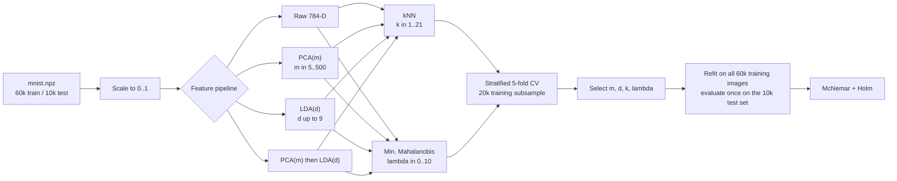
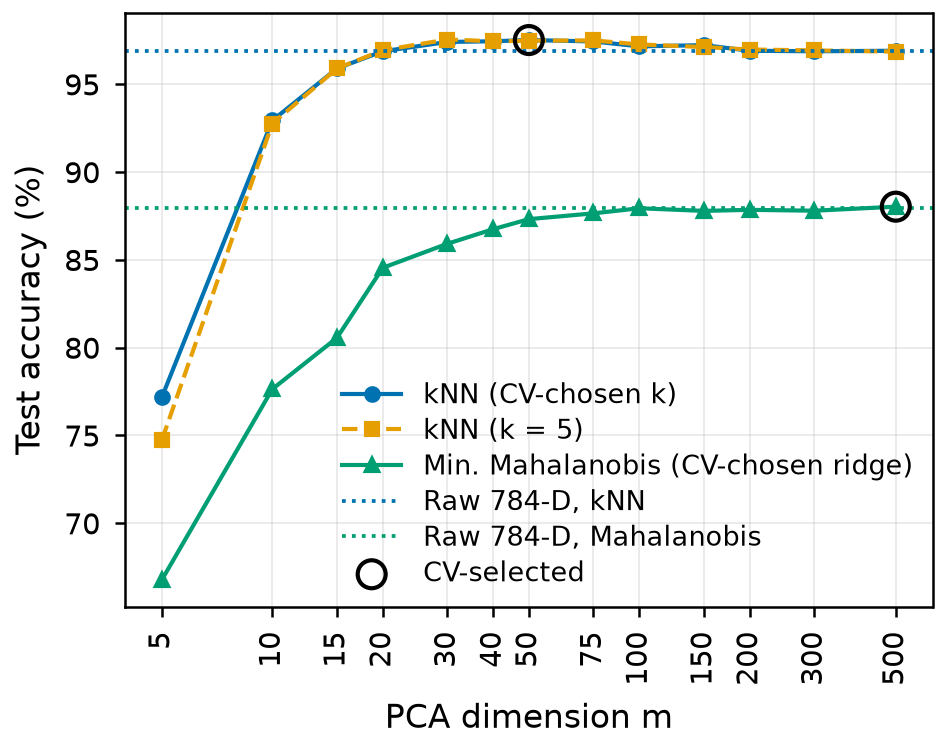
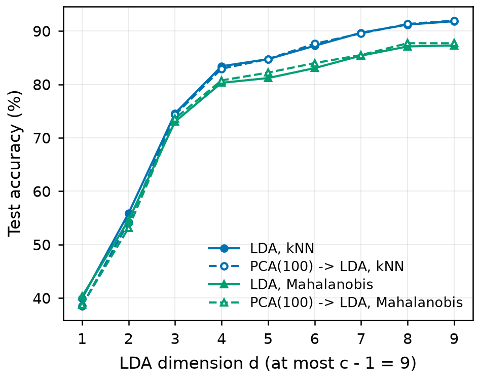

# Dimensionality Reduction for Handwritten-Digit Classification

A controlled comparison of PCA, LDA and PCA→LDA feature extraction on MNIST. Two classifiers are tested, k-nearest
neighbours and a minimum-Mahalanobis-distance rule. Every hyper-parameter is selected by cross-validation on the
training set only.

*Coursework project for IE4476.*

## Problem
Reducing 784 pixel features to a few dozen can make classification faster and sometimes more accurate, but the answer
depends on the projection, the classifier and how the dimensionality is chosen. Picking the dimensionality by looking
at test accuracy, which is common in coursework, biases the result. This project asks the question with a protocol in
which the test set cannot influence any choice.

## Objectives
1. Compare four feature pipelines: raw pixels, PCA(m), LDA(d ≤ 9), and PCA(m) followed by LDA(d).
2. Compare two classifiers on each: kNN (Euclidean) and minimum Mahalanobis distance (pooled covariance with ridge λ).
3. Select m, d, k and λ by stratified 5-fold cross-validation on training data only. Then report test accuracy once.
4. Test whether the differences are statistically significant: paired McNemar tests with Holm correction.

## Key features
- **Training-only selection.** The test images are loaded only after all selection is finished. A test checks this
  (`tests/test_protocol.py`).
- **One PCA solver everywhere:** eigendecomposition of the training covariance, so every m uses the same basis.
- A Mahalanobis classifier with a relative ridge. λ = 0 is allowed only when the pooled covariance is well
  conditioned.
- Exact McNemar tests on the discordant predictions, Holm-corrected across 7 planned comparisons.
- A reproducibility check against the first version: v2 recomputes v1's k = 5 numbers (96.88% raw, 97.55% PCA-30)
  exactly.
- Seeded and logged. The run log records the package versions, the data checks and the time spent in each stage.

## Architecture


## Technologies
Python 3.14, NumPy, SciPy, scikit-learn (LDA, stratified folds), Matplotlib, pytest.

## Project structure
```
├── v2/
│   ├── main_v2.py          # the experiment (all pipelines, CV, test, McNemar, figures)
│   ├── replot_figures.py   # redraws the figures from the CSVs
│   ├── results/            # CSVs and run_log.txt of the reported run (pilot/ and smoke/ = sizing runs)
│   └── figures/
├── main.py                 # v1: PCA + kNN with k = 5 (kept as the baseline that v2 reproduces)
├── verify_results.py       # independent re-check of the v1 results and its McNemar test
├── generate_report.py      # v1 report generator (optional, needs python-docx)
├── results/, figures/      # v1 outputs
├── scripts/fetch_mnist.py  # downloads and hash-checks the dataset
└── tests/                  # protocol, consistency and README checks
```

## Installation
```bash
python3.14 -m venv .venv && source .venv/bin/activate
pip install -r requirements-dev.txt
python scripts/fetch_mnist.py          # writes data/mnist.npz (SHA-256 verified; not committed)
```

## Running
```bash
python -B v2/main_v2.py                # the full experiment (logged run 16.3 min; a re-run took 2.2 min, same results)
python -B v2/main_v2.py --pilot        # quick sizing run (CV subsample 5000) into v2/results/pilot
python -B v2/replot_figures.py         # redraw figures from the CSVs
python -B main.py                      # v1 baseline
python -B verify_results.py            # re-check of v1 (reads only)
pytest                                 # tests run on synthetic digits, no download needed (about 5 s)
```

## Results
Test accuracy on the 10,000 MNIST test images. Each value uses the configuration selected by cross-validation
(`v2/results/test_results.csv`, `selected_config.csv`).

<!-- results-table -->
| Pipeline | kNN setting | kNN accuracy | Mahalanobis setting | Mahalanobis accuracy |
|---|---|---|---|---|
| Raw | k = 1 | 96.91% | λ = 1 | 87.93% |
| PCA | m = 50, k = 3 | 97.52% | m = 500, λ = 1 | 88.03% |
| LDA | d = 9, k = 7 | 91.83% | d = 9, λ = 0 | 87.30% |
| PCA_LDA | m = 100, d = 9, k = 9 | 91.95% | m = 100, d = 9, λ = 0 | 87.71% |
<!-- results-table -->

Significance (`v2/results/mcnemar.csv`, exact McNemar, Holm-corrected):
- **PCA(50) + kNN beats raw-pixel kNN:** 97.52% vs 96.91%. Discordant pairs are 132 vs 71; p = 2.2·10⁻⁵, Holm
  4.4·10⁻⁵.
- **LDA-based pipelines lose to raw kNN** by about 5 points (p < 10⁻⁸⁰). LDA keeps only c − 1 = 9 axes, too few for kNN
  on this data.
- **PCA does not improve the Mahalanobis classifier:** 88.03% vs 87.93%, p = 0.25.
- **kNN beats Mahalanobis** on every pipeline. A single pooled covariance underfits the digit classes.

Training-set facts from the log: 87, 154 and 331 components are needed for 90%, 95% and 99% of the variance.

| PCA dimensionality vs accuracy | LDA dimensionality vs accuracy |
|---|---|
|  |  |

**Verification.**
- `tests/test_results_files.py` recomputes every McNemar p-value and every Holm adjustment from the committed counts.
  It also checks that each test row uses exactly the CV-selected setting, and that this table matches the CSV.
- `tests/test_protocol.py` runs the real pipeline on synthetic digits. It checks that the test set is loaded only after
  selection, and that the same seed gives the same CV table.

## Limitations
- CV uses a stratified 20,000-image training subsample (sized from the pilot run) to keep the grid search under
  about 7 minutes. The final models are refit on all 60,000 images.
- One dataset; MNIST is close to saturated for kNN.
- The Mahalanobis rule uses one pooled covariance. Class-specific covariances (QDA) were not tested.
- Timings come from one machine and are indicative only.

## Future work
Class-specific covariance models, nonlinear projections (kernel PCA, autoencoders), and a second dataset such as
Fashion-MNIST, where kNN is far from saturated.

## References
1. LeCun, Y., Cortes, C., Burges, C. J. C. The MNIST database of handwritten digits.
2. Jolliffe, I. T., Cadima, J. (2016). Principal component analysis: a review and recent developments.
   *Phil. Trans. R. Soc. A* 374: 20150202.
3. Fisher, R. A. (1936). The use of multiple measurements in taxonomic problems. *Annals of Eugenics* 7(2).
4. McNemar, Q. (1947). Note on the sampling error of the difference between correlated proportions or percentages.
   *Psychometrika* 12(2).
5. Holm, S. (1979). A simple sequentially rejective multiple test procedure. *Scand. J. Statistics* 6(2).

The dataset is not redistributed here; `scripts/fetch_mnist.py` downloads the standard copy.

## Author
Kasturiraj Guhan Govindraj
